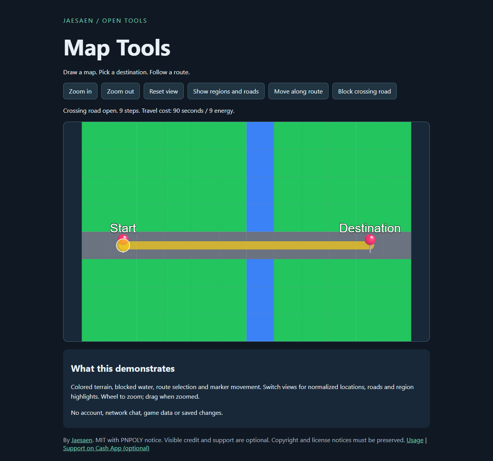

# ChatBound Map Tools

Reusable map drawing and route helpers extracted from Chat-Bound RPG. Browser-ready JavaScript, no runtime dependencies, and TypeScript declarations included.


[Try the browser demo](https://jaesonmoment.github.io/chatbound-map-tools/) | [Download v0.1.0](https://github.com/Jaesonmoment/chatbound-map-tools/releases/tag/v0.1.0)



## Try it

Serve this folder with any static web server and open `index.html`. ES modules require HTTP rather than opening an HTML file directly. The demo uses plain geometry, colored terrain, locations, regions and roads. Click a reachable cell to preview a route, then use Move to animate the marker. Wheel to zoom, drag after zooming, or use the buttons.

One concrete preview path: prerequisite Python 3.8 or newer already installed and available as `python`. Open a terminal in this package's folder and run:

```text
python -m http.server 8000 --bind 127.0.0.1
```

Then open **http://127.0.0.1:8000/** in your browser. Keep that terminal open while previewing; Ctrl+C stops the server. No package install is needed. This is a local preview server, not production hosting.

No installation is needed to use the library. Copy `src/` into your project along with `LICENSE` and `NOTICE.md`:

```js
import { WorldMapCanvas, findPath } from './src/index.js';
const grid = [['road', 'road'], ['grass', 'road']];
const view = new WorldMapCanvas(document.querySelector('canvas'));
view.resize(640, 400);
view.setGrid(2, 2, grid);
view.setPlayerPos(0, 0);
const route = findPath(grid, { x: 0, y: 0 }, { x: 1, y: 1 });
view.setTravelPath(route?.cells ?? []);
// When removing the view:
view.destroy();
```

## Supported behavior

- Terrain grids, normalized coordinates, location markers, region hotspots, road traces and travel paths.
- Background bitmaps preserve their aspect ratio with contain or cover fitting. Call `setBackgroundBitmap` with an image/canvas you own. The library does not upload images.
- Zoom/pan and movement animation. `destroy()` removes owned listeners and animation resources.
- Grid routing minimizes summed, rounded travel seconds. Four neighboring cells, no diagonal movement. Both endpoints must be passable and unblocked. The search stops at 10,000 visited iterations and may return null on larger maps.
- Waypoint routing minimizes travel seconds, respects direction and blocked edges, and excludes impassable terrain. Distance weights must be 0.1-100; speeds must be positive and finite. Missing destinations return null.
- Configurable positive terrain speeds and nonnegative energy costs. Invalid costs throw. Grid terrain names must be known; malformed serialized grids fall back to grass.
- Polygon testing uses the original PNPOLY semi-open boundary rule. A boundary point can be inside or outside consistently. It does not promise every edge is inside. Use simple polygons; no hole or self-intersection guarantees. Invalid polygons return false. Region lookup returns the first match.

There is no editor, upload service, portal system, saved journey, game account, database or reward system. Existing game integrations are intentionally excluded. Browser demo acceptance and screenshots are recorded separately from automated checks.

## Checks

Node 22 or newer: `npm test` (or `node --test`). Tests use only Node's built-in test runner. No install step. The included workflow runs the same checks. Renderer tests use a fake canvas to check calculations and cleanup; they are not visual browser acceptance.

## License and credit

Project code: MIT, copyright [Jaesaen](https://github.com/Jaesonmoment). PNPOLY carries its original redistribution conditions in `NOTICE.md`; retain them. Visible credit to Jaesaen and optional support are appreciated, not required. No royalties. See `PROVENANCE.md` for source lineage and copied-library repairs.

## Optional support

If this tool helps you, you can [support Jaesaen on Cash App](https://cash.app/$jaesaen). Support is voluntary and is not required to use, modify or redistribute the tool under its license. The demo and GitHub funding entry use this same external support link. This project does not collect payment information or process donations.
